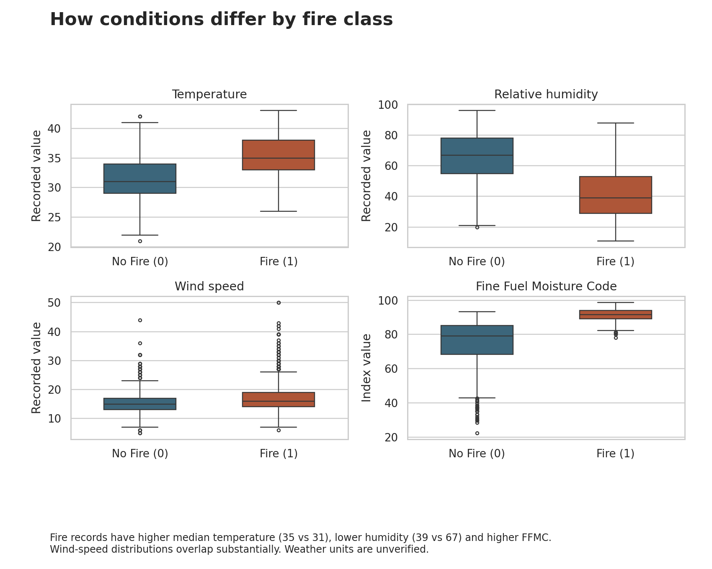
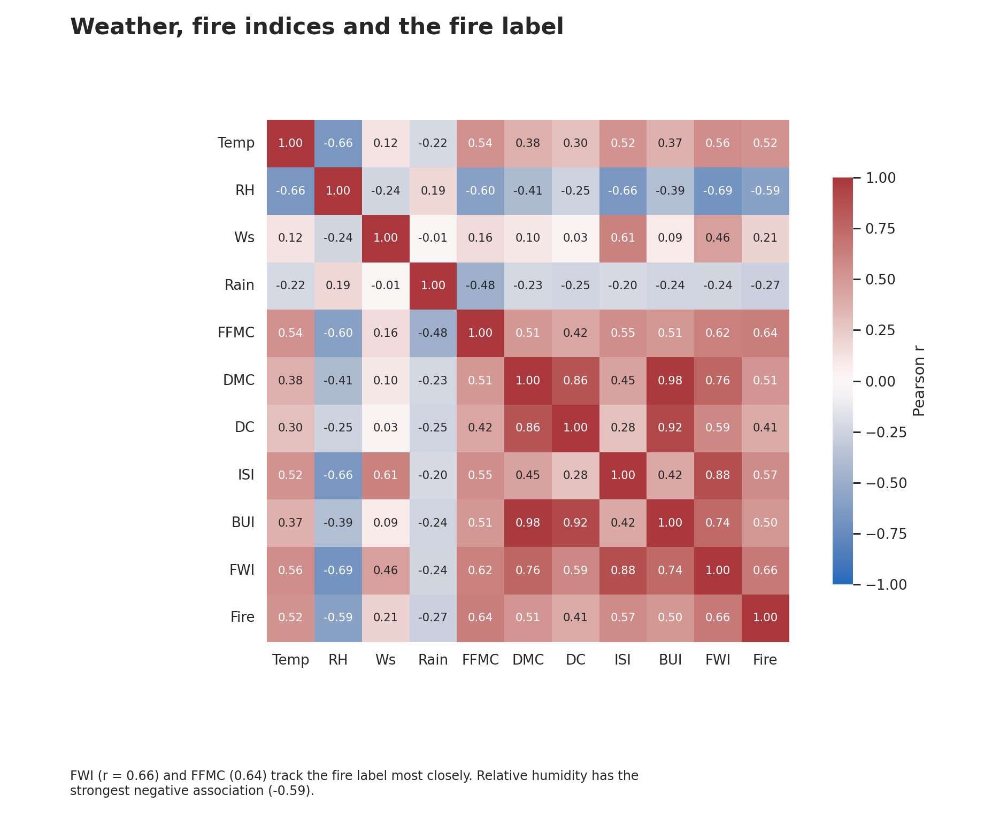
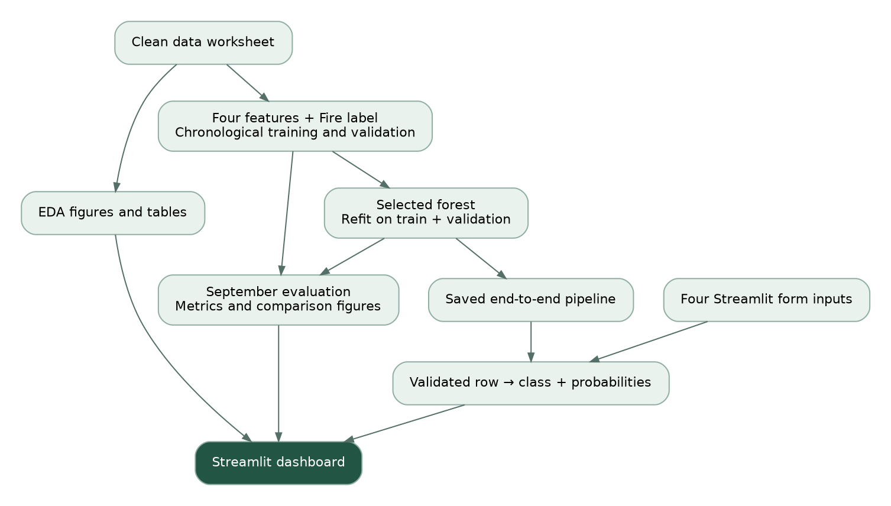

# Wildfire Prediction System

A college data science project that asks **“Given four environmental readings for a region-day, which label does the model assign: Fire or No Fire?”** The Streamlit app explores the data, compares three classifiers, and runs the fitted Random Forest locally. It performs **same-day classification**. Independent validation of future wildfire forecasting is outside the evidence supplied by this dataset.

## Run on a Mac with VS Code

1. Extract the ZIP and open the **Wildfire_Project** folder in VS Code. The Explorer should show both app.py and requirements.txt.
2. Open **Terminal → New Terminal**. With Python 3.12 installed, run:

   ```bash
   python3.12 -m venv .venv
   source .venv/bin/activate
   python -m pip install -r requirements.txt
   python -m streamlit run app.py
   ```

3. Open the local URL printed in the terminal. Use the sidebar for Overview Dashboard, Exploratory Data Analysis, ML Model Performance, and Wildfire Prediction. Use Control+C to stop the server. On the next launch, reactivate the environment and run the last command.

The trained model is included. For slides or offline viewing, double-click [the standalone chart gallery](docs/charts.html). For the presentation, use [the demo script and viva guide](docs/presentation.md).

## Streamlit Community Cloud

Deploy this repository from the `main` branch with `app.py` as the entrypoint.
In Advanced settings, select **Python 3.12**. Community Cloud installs the pinned
packages in `requirements.txt`. No API keys, secrets, or model retraining are
required: the workbook, model, figures, and result tables are bundled in the repo.

Keep `model/`, `data/`, `assets/`, and `results/` alongside `app.py`. The application
resolves those files relative to its own location and verifies the workbook and
model before using them. Do not upload a virtual environment or a secrets file.

## Project files

| Location | Contents |
|---|---|
| app.py, predict.py, preprocessing.py | Dashboard, validated prediction helper, four-column contract and model pipelines |
| data/wildfire.xlsx | Clean data, source dictionary, changes, date gaps and outlier review |
| analysis/ | Executable EDA, preprocessing audit, training and evaluation scripts |
| model/ | Trusted final pipeline and selection metadata |
| assets/eda/, assets/evaluation/ | Eight EDA figures and five evaluation figures |
| results/ | Final test, calibration, validation, probabilities and permutation-importance CSVs |
| results/eda/, results/audit/, results/training/ | Descriptive tables, split manifest, tuning scores, baselines and six saved candidate pipelines |
| tests/, TEST_REPORT.md, docs/evidence/ | Automated app and model tests, test scope and execution records |
| docs/ | Offline charts, presentation material and system diagram |

## Data and exploratory findings

The **Clean data** sheet contains 1,215 region-days, 18 columns and nine Algerian regions. The observed seasons are June–September in 2012, 2017 and 2021. Region coverage differs by year. Fire accounts for 633 observations (52.1%) and No Fire for 582 (47.9%).

| Fields | Meaning and use |
|---|---|
| temperature, wind_speed, rain, relative_humidity | The four user-entered measurements, in model input order. Observed ranges are 21–43, 5–50, 0–20.2 and 11–96 respectively. The original workbook leaves physical units and rainfall time window undocumented. |
| FFMC, DMC, DC | Fine Fuel Moisture Code, Duff Moisture Code and Drought Code, using the workbook dictionary's conventional interpretations |
| ISI, BUI, FWI | Initial Spread Index, Buildup Index and Fire Weather Index. All six indices appear in EDA. Their availability at prediction time and their relationship to label generation remain unverified. |
| fire, class_label | Numeric target (1 = Fire, 0 = No Fire) and its text equivalent. Neither enters the predictors. |
| date, region, source_year, source_group, source_row, date_status | Geography, time and audit metadata. Date and region support evaluation; source_row links predictions to workbook rows. |



Median temperature was 35 in Fire records and 31 in No Fire records. Relative humidity showed a wider separation, with medians of 39 and 67. Median wind speeds were closer at 16 and 15. These are recorded values in unverified units.



FWI had the strongest positive correlation with the Fire label (0.66). Relative humidity had the strongest negative correlation (−0.59). DMC and BUI were highly correlated (0.98). Among regions, Tiaret recorded 87 Fire labels in 122 observations and Tipaza 30 in 122. The difference spans distinct years. [Regional chart](assets/eda/08_region.png) · [Year-by-month chart](assets/eda/09_monthly.png)

There are zero missing cells or duplicated region–date keys. Five Khenchela dates are absent. Five **inferred date corrections** in Setif are excluded from chronological analyses. Including them changes September 2021 from 73/205 to 74/210 Fire observations. All genuine observed extremes were retained. The 1.5 × IQR rule flags 732 readings across 428 rows; narrow rainfall quartiles explain 248 flags. [Detailed EDA tables](results/eda/)

## Feature selection, preprocessing and training

The four-column whitelist matches what a user can supply. It excludes the duplicate text target, bookkeeping, geography, and the six indices. A median imputer fits within each training fold. Logistic Regression also standardizes its inputs. Trees use original-scale values. Classes are approximately balanced, so training uses their original frequencies. Range validation in the app uses observed limits and requires all four readings.

| Stage | Rows | Role |
|---|---:|---|
| Through July 2021 | 793 | Fit baselines and tune with expanding date blocks |
| August 2021 | 212 | Compare candidates and decide on calibration |
| September 2021 | 205 | Evaluate the selected model after refitting on 1,005 eligible train + validation rows |
| Inferred dates | 5 | Exclude from time-sensitive fitting and evaluation |

All regions observed on an eligible date stay together. The tuning folds validate on summer 2017, June 2021 and July 2021 using only earlier dates for fitting. GridSearchCV evaluates 29 settings using mean Fire F1; classifier seeds are 42. Thirty-five distinct four-reading combinations occur with both labels, so the inputs alone cannot fully separate recorded outcomes.

| Classifier | How it works | Selected settings |
|---|---|---|
| Logistic Regression | Computes a weighted sum of standardized readings and maps it to a probability. Regularization controls coefficient magnitude. | C = 10 |
| Decision Tree | Splits readings at thresholds and estimates the class distribution in each terminal leaf. Depth and minimum leaf size constrain overfitting. | Depth 3, minimum leaf size 8 |
| Random Forest | Fits trees on bootstrap samples and averages their leaf class probabilities. | 200 trees, depth 10, minimum leaf size 8, all four features considered at splits |

## Model comparison and selection

August validation scores are rounded below. Precision, recall and F1 use Fire as the positive class. Brier score measures squared probability error, with lower values preferred.

| Model | Baseline F1 | Tuned F1 | Precision | Recall | Accuracy | ROC-AUC | Brier |
|---|---:|---:|---:|---:|---:|---:|---:|
| Logistic Regression | .846 | .856 | .766 | .970 | .797 | .929 | .120 |
| Decision Tree | .793 | .860 | .799 | .932 | .811 | .838 | .143 |
| Random Forest | .843 | **.871** | .806 | .947 | .825 | .891 | .130 |

Random Forest ranked first on the chosen Fire F1 criterion. It produced 30 false alarms and missed seven Fire records. Logistic Regression missed only four but produced 39 false alarms. It also led on ROC-AUC, Brier score and mean tuning-fold F1. The forest’s fold F1 scores ranged from .552 to .941, so its August lead should be interpreted in light of temporal variation.

The July-held-out sigmoid calibration recipe raised August Brier from .130 to .160 and lowered F1. It also gave the underlying forest fewer fitting rows. The project retained the raw forest probabilities and default class decision before evaluating September. [Comparison CSV](results/august_comparison.csv) · [Calibration experiment](results/calibration_trial.csv)

**Final September test:** 70 correctly detected Fire, 3 missed Fire, 39 false alarms and 93 correctly identified No Fire. Accuracy was **.795**, Fire precision **.642**, recall **.959**, F1 **.769**, ROC-AUC **.969** and Brier **.133**. Among 29 September observations assigned 60–80% Fire, six had a Fire label. The percentages estimate same-day class membership; their accuracy as real-world ignition chances has not been established. Shuffling relative humidity reduced September F1 by .200 on average, the largest decrease among the inputs. [Test scores](results/september_test.csv) · [Reliability plot](assets/evaluation/04_reliability.png) · [Feature importance](assets/evaluation/05_importance.png)

## System architecture and data flow



Training and evaluation run offline. The app loads the packaged workbook, figures, comparison results and selected model. Clicking Predict validates the four fields, checks the model file against its expected digest before loading, and passes a named numeric row through the fitted pipeline. The helper maps predict_proba columns through classes_, checks that probabilities sum to one, and returns the predicted label and both percentages.

## Reproduce from the workbook

From the project root with the virtual environment active:

```bash
python -m analysis.wildfire_eda data/wildfire.xlsx --output reproduced/eda
python -m analysis.prepare data/wildfire.xlsx --output reproduced/audit
python -m analysis.train data/wildfire.xlsx --output reproduced/training
python -m analysis.evaluate data/wildfire.xlsx reproduced/training
python -m unittest discover -s tests -v
```

The first four commands regenerate the figures, audits, candidates and evaluation under reproduced/. The app uses the original verified release artifact under model/. Dependencies are pinned in requirements.txt. [Recorded verification](docs/evidence/) · [Integration test details](TEST_REPORT.md)

## Limitations and future work

- Observations cover three summer seasons and a limited set of regions. September tests later dates in familiar regions. Validate on independently collected regions and years before claiming transfer.
- Source units, measurement windows, label collection and five inferred year fixes need provider confirmation. Add independently verified event labels and measurement metadata.
- Recall was high in September, but false alarms reduced precision. Assess calibration and threshold choices over multiple unseen seasons with a threshold chosen using development data.
- A future forecast needs a specified lead time, within-region future outcome labels, and inputs known by a declared forecast cutoff. This application is a college demonstration of same-day classification and has no operational warning role.
